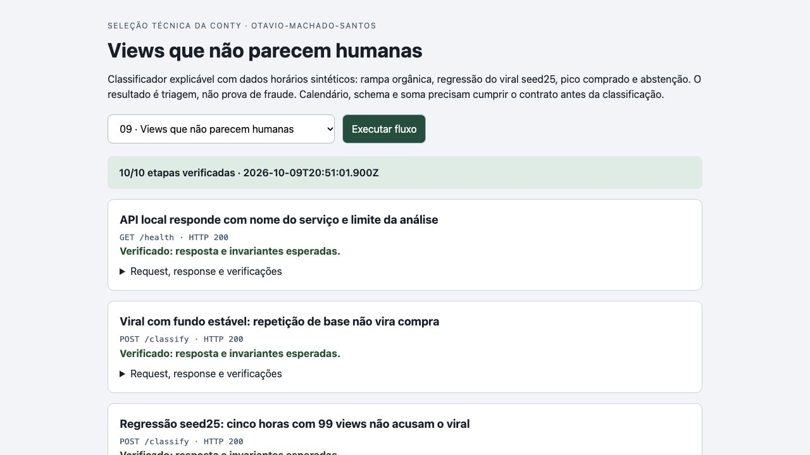
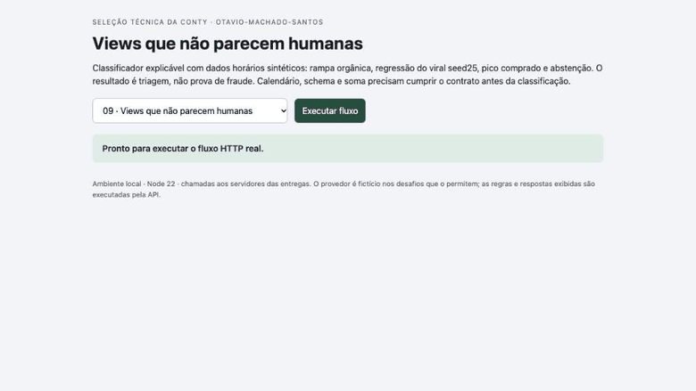

# Verificação final da entrega 9

Código revisado: `829b1bc9cf4df285c8f867cdd6166799fd862659`. Runtime: Node.js 22.23.3 em macOS.

Implementação e documentação: MiMo CLI (mimo-v2.6-pro), com ajustes pontuais Codex na escrita integral antes do rename e no isolamento da limpeza do teste. Revisão: dois agentes Codex independentes do implementador. Não houve revisão humana do código.

- 53 testes passaram no código final; [checkout isolado](evidence/coordenador-clone-limpo.txt).
- [Parecer A](reviews/09-a.json) e [parecer B](reviews/09-b.json), com sondagens independentes, limites e sugestões.
- [Transcrição HTTP real](evidence/coordenador-http.json): 10 etapas verificadas, com requests, respostas e invariantes.
- [Screenshot](evidence/screen.jpg), [resposta expandida](evidence/response.jpg) e [GIF da execução real](evidence/flow.gif).

O GIF foi codificado dos frames de screencast do navegador durante a execução das chamadas locais; não é uma montagem ou simulação. Os dados são fictícios. O portal apenas apresenta respostas da API e compara invariantes. As integrações externas são mockadas quando previsto no enunciado. Os limites de persistência, autenticação e operação estão no README. Os testes e capturas não representam deploy ou funcionamento em produção.

